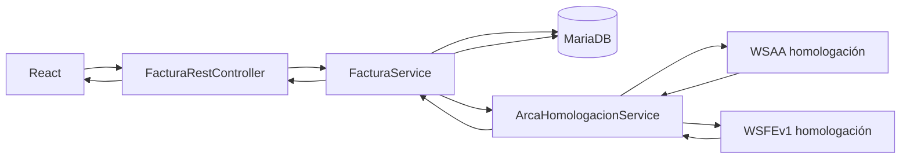

# Guía para presentar el sistema de facturación con ARCA

Esta guía explica dónde está cada parte importante del proyecto y cómo recorrer el código paso a paso durante una presentación.

## 1. Resumen del sistema

El proyecto es una aplicación de facturación compuesta por:

- Backend Java 17 con Spring Boot y Gradle.
- Persistencia JPA/Hibernate sobre MariaDB.
- Frontend React, TypeScript y Vite.
- Integración con WSAA y WSFEv1 de ARCA en homologación.
- Generación de comprobantes PDF y reportes PDF/XLSX.
- Colección Postman v2.1 para probar la API completa.

El flujo principal es:



Una factura se guarda primero como `SIN_EMITIR`. El número fiscal, la fecha de emisión y el CAE se asignan solamente cuando ARCA aprueba el comprobante.

## 2. ¿Dónde está el núcleo de Spring?

### Punto de entrada

La aplicación comienza en [`DemoApplication.java`](src/main/java/com/example/demo/DemoApplication.java).

La anotación `@SpringBootApplication` hace tres cosas principales:

1. Activa la configuración automática de Spring Boot.
2. Busca componentes dentro de `com.example.demo`.
3. Registra controladores, servicios, repositorios y configuraciones como beans.

### ¿Es Maven o Gradle?

Este proyecto no usa `pom.xml`. Usa Gradle y su definición principal está en [`build.gradle`](build.gradle).

Allí se encuentran:

- Plugin de Java.
- Plugin de Spring Boot.
- Spring Web MVC.
- Spring Data JPA.
- Bean Validation.
- Driver de MariaDB.
- Bouncy Castle para firmar el TRA de ARCA.
- OpenPDF para los reportes PDF generales.
- Handlebars.java y OpenHTMLToPDF para el comprobante fiscal individual.
- ZXing para generar el QR fiscal de ARCA.
- Apache POI para XLSX.
- Lombok.

En Maven estas dependencias estarían en `pom.xml`; en este proyecto cumplen esa función los bloques `plugins` y `dependencies` de `build.gradle`.

### Configuración general

La configuración está en [`application.properties`](src/main/resources/application.properties).

Variables de MariaDB:

```properties
DB_URL
DB_USERNAME
DB_PASSWORD
```

Variables de ARCA:

```properties
ARCA_CUIT
ARCA_CONDICION_IVA_EMISOR
ARCA_KEYSTORE_PATH
ARCA_KEYSTORE_PASSWORD
```

Los endpoints configurados son exclusivamente de homologación:

```text
WSAA: https://wsaahomo.afip.gov.ar/ws/services/LoginCms
WSFE: https://wswhomo.afip.gov.ar/wsfev1/service.asmx
```

Los certificados y contraseñas no están guardados en Git. Spring obtiene sus valores desde las variables configuradas en IntelliJ o en el entorno del proceso.

## 3. Capas del backend

### Controladores REST

Los controladores reciben HTTP y delegan la lógica a los servicios.

- [`FacturaRestController.java`](src/main/java/com/example/demo/controller/FacturaRestController.java): facturas, emisión ARCA, PDF, reportes y diagnóstico de homologación.
- [`DatosMaestrosRestController.java`](src/main/java/com/example/demo/controller/DatosMaestrosRestController.java): clientes, artículos, listas de precios, monedas, condiciones de IVA y puntos de venta.

El controlador no firma certificados ni calcula facturas. Su responsabilidad es traducir la petición HTTP, validar el DTO y devolver el código HTTP correspondiente.

### Servicios

- [`FacturaService.java`](src/main/java/com/example/demo/service/FacturaService.java): núcleo de negocio de facturación.
- [`ArcaHomologacionService.java`](src/main/java/com/example/demo/service/ArcaHomologacionService.java): autenticación WSAA y emisión WSFE.
- [`DatosMaestrosService.java`](src/main/java/com/example/demo/service/DatosMaestrosService.java): clientes, artículos y catálogos.
- [`ReporteExportService.java`](src/main/java/com/example/demo/service/ReporteExportService.java): punto de entrada para comprobantes y reportes PDF/XLSX.
- [`FacturaTemplatePdfService.java`](src/main/java/com/example/demo/service/FacturaTemplatePdfService.java): arma el modelo fiscal, completa la plantilla Handlebars, genera el QR ARCA y renderiza el comprobante individual.
- [`factura.hbs`](src/main/resources/templates/factura.hbs): estructura visual A4 del comprobante basada en la plantilla de `storemanager`.

### Repositorios

- [`FacturaEscrituraRepository.java`](src/main/java/com/example/demo/repository/FacturaEscrituraRepository.java): persistencia y bloqueos de escritura.
- [`FacturaReporteRepository.java`](src/main/java/com/example/demo/repository/FacturaReporteRepository.java): consultas y proyecciones para reportes.

### Entidades principales

- [`FacturaVenta.java`](src/main/java/com/example/demo/model/FacturaVenta.java): cabecera, estado, importes, CAE y relaciones.
- [`FacturaVentaDetalle.java`](src/main/java/com/example/demo/model/FacturaVentaDetalle.java): renglones, cantidades, IVA e importes.
- [`Cliente.java`](src/main/java/com/example/demo/model/Cliente.java): cliente y condición fiscal.
- [`Articulo.java`](src/main/java/com/example/demo/model/Articulo.java): producto.
- [`ListaPrecio.java`](src/main/java/com/example/demo/model/ListaPrecio.java): lista minorista o mayorista.
- [`ListaPrecioArticulo.java`](src/main/java/com/example/demo/model/ListaPrecioArticulo.java): precio de un artículo dentro de una lista.
- [`PuntoVenta.java`](src/main/java/com/example/demo/model/PuntoVenta.java): punto de venta fiscal.
- [`EstadoFactura.java`](src/main/java/com/example/demo/model/EstadoFactura.java): estados admitidos.

### DTO

Los DTO evitan exponer entidades JPA directamente:

- [`FacturaRequestDTO.java`](src/main/java/com/example/demo/dto/FacturaRequestDTO.java): creación y edición de borradores.
- [`FacturaVistaDTO.java`](src/main/java/com/example/demo/dto/FacturaVistaDTO.java): detalle completo para visualizar.
- [`FacturaReporteDTO.java`](src/main/java/com/example/demo/dto/FacturaReporteDTO.java): listado resumido.
- [`ArcaEmisionDTO.java`](src/main/java/com/example/demo/dto/ArcaEmisionDTO.java): resultado de emitir.
- [`ArcaConfiguracionDTO.java`](src/main/java/com/example/demo/dto/ArcaConfiguracionDTO.java): diagnóstico sin secretos.
- [`ArcaAutenticacionDTO.java`](src/main/java/com/example/demo/dto/ArcaAutenticacionDTO.java): resultado seguro de probar WSAA.

## 4. Cómo se crea un borrador

El frontend llama:

```http
POST /api/facturas
```

Recorrido:

1. [`FacturaRestController`](src/main/java/com/example/demo/controller/FacturaRestController.java) recibe un `FacturaRequestDTO` con `@Valid`.
2. [`FacturaService.crear`](src/main/java/com/example/demo/service/FacturaService.java) abre una transacción `READ_COMMITTED`.
3. Busca punto de venta, cliente, condición de IVA, moneda, lista y usuario por sus IDs.
4. Comprueba que la condición de IVA recibida coincida con la condición fiscal del cliente.
5. Reemplaza los detalles dentro de la misma transacción.
6. Toma el precio desde `ListaPrecioArticulo` y valida que pertenezca al artículo y a la lista seleccionada.
7. Calcula neto, bonificación, IVA, subtotal, total, cobrado y saldo con `BigDecimal`.
8. Guarda la factura como `SIN_EMITIR`.
9. Deja `numero`, `fechaEmision`, `cae` y vencimiento de CAE en `null`.
10. Devuelve `201 Created` con cabecera `Location`.

No se confía en los totales enviados por el navegador. El backend recalcula los importes.

## 5. Estados e inmutabilidad

Los estados están definidos en [`EstadoFactura.java`](src/main/java/com/example/demo/model/EstadoFactura.java):

```text
SIN_EMITIR -> EMITIDA -> ANULADA
```

Reglas:

- Solamente una factura `SIN_EMITIR` puede editarse o eliminarse.
- Solamente una factura `SIN_EMITIR` puede enviarse a ARCA.
- Al aprobar ARCA pasa a `EMITIDA`.
- Una factura emitida o anulada no puede modificarse mediante el `PUT` general.
- Los intentos incompatibles devuelven `409 Conflict`.

La operación `/anular` cambia el estado interno. No revierte fiscalmente un comprobante autorizado: una anulación fiscal real requiere una nota de crédito.

## 6. Concurrencia y numeración fiscal

La parte crítica está repartida entre:

- [`FacturaService.emitirConArca`](src/main/java/com/example/demo/service/FacturaService.java)
- [`FacturaEscrituraRepository`](src/main/java/com/example/demo/repository/FacturaEscrituraRepository.java)
- [`FacturaVenta`](src/main/java/com/example/demo/model/FacturaVenta.java)

Al emitir se aplica:

1. Transacción con aislamiento `READ_COMMITTED`.
2. Bloqueo `PESSIMISTIC_WRITE` de la factura.
3. Bloqueo `PESSIMISTIC_WRITE` del punto de venta.
4. Nueva comprobación del estado después de obtener el bloqueo.
5. Consulta del último comprobante autorizado a ARCA.
6. Solicitud del número inmediatamente siguiente.
7. Restricción única en MariaDB para `(punto_venta_id, tipo_comprobante, numero)`.
8. Campo `@Version` para detectar actualizaciones concurrentes fuera del flujo bloqueado.

El punto de venta se bloquea porque la secuencia fiscal pertenece al par punto de venta/tipo de comprobante, no a una factura individual.

## 7. Cómo se autentica contra ARCA

La autenticación está en el método privado `ticket()` de [`ArcaHomologacionService.java`](src/main/java/com/example/demo/service/ArcaHomologacionService.java).

### Paso 1: cargar el PKCS#12

El servicio abre el archivo indicado por `ARCA_KEYSTORE_PATH`, usa `ARCA_KEYSTORE_PASSWORD` y obtiene:

- Clave privada RSA.
- Certificado X.509.

También valida que el certificado esté vigente.

### Paso 2: construir el TRA

Se genera un XML `loginTicketRequest` con:

- `uniqueId`.
- `generationTime`.
- `expirationTime`.
- Servicio `wsfe`.

### Paso 3: firmar

Bouncy Castle firma el TRA con `SHA256withRSA` y genera un CMS/PKCS#7. El CMS se codifica en Base64.

### Paso 4: llamar a WSAA

El CMS se envía a `loginCms` en WSAA homologación.

WSAA devuelve:

- `token`.
- `sign`.
- `expirationTime`.

El ticket se conserva únicamente en memoria y se reutiliza mientras falten más de cinco minutos para su vencimiento. El método está sincronizado para impedir que varios hilos generen tickets simultáneamente.

La aplicación nunca devuelve `token` ni `sign` al frontend o a Postman.

### Endpoint para probarlo

```http
POST /api/facturas/arca/probar-autenticacion
```

Este endpoint firma el TRA y obtiene el ticket, pero devuelve solamente ambiente, servicio, vencimiento y estado de autenticación.

## 8. Cómo se solicita el CAE

El frontend llama:

```http
POST /api/facturas/{id}/emitir
```

### Paso 1: determinar el tipo de comprobante

La condición del emisor se obtiene de:

```properties
ARCA_CONDICION_IVA_EMISOR=MONOTRIBUTO
```

La integración actual admite monotributista o exento y usa:

```text
CbteTipo = 11 = Factura C
```

La condición fiscal del cliente no cambia la letra C cuando el emisor es monotributista, pero sí se envía a ARCA en `CondicionIVAReceptorId`.

### Paso 2: obtener el último número

Se invoca `FECompUltimoAutorizado` con:

- CUIT emisor.
- Punto de venta.
- Tipo de comprobante 11.

El nuevo número es el último autorizado más uno.

### Paso 3: construir `FECAESolicitar`

La solicitud contiene:

- Punto de venta.
- Tipo y número de comprobante.
- Fecha fiscal.
- Documento del receptor.
- Condición de IVA del receptor.
- Moneda y cotización.
- Importe total.

Para Consumidor Final se utiliza documento tipo 99 y número 0. Para un cliente registrado, actualmente se envía documento tipo 80 y el CUIT/CUIL normalizado a dígitos.

### Paso 4: procesar la respuesta

Si ARCA devuelve `Resultado=A` y un CAE:

- Se guarda el número fiscal.
- Se asigna la fecha de emisión.
- Se guarda el CAE.
- Se guarda su vencimiento.
- Se registra el resultado de ARCA.
- El estado pasa a `EMITIDA`.

Si ARCA rechaza:

- La factura permanece `SIN_EMITIR`.
- Se guardan el resultado y el motivo.
- El frontend muestra un modal y una alerta Sileo.

### Qué función obtiene y guarda el CAE

La operación se divide en dos funciones principales:

1. [`ArcaHomologacionService.solicitarCae`](src/main/java/com/example/demo/service/ArcaHomologacionService.java) se comunica con WSFE.
2. [`FacturaService.emitirConArca`](src/main/java/com/example/demo/service/FacturaService.java) aplica el resultado sobre la factura y lo persiste.

El recorrido exacto es:

```text
POST /api/facturas/{id}/emitir
        |
        v
FacturaRestController.emitirFactura(id)
        |
        v
FacturaService.emitirConArca(id)
        |
        v
ArcaHomologacionService.emitir(factura, fechaComprobante)
        |
        +--> ticket()                    Autenticación WSAA
        +--> ultimoAutorizado()          FECompUltimoAutorizado
        +--> solicitarCae()              FECAESolicitar
                                            |
                                            v
                                      Respuesta XML de ARCA
                                            |
                                            v
                                       ResultadoArca
                                            |
                                            v
                                  FacturaService guarda en MariaDB
```

#### `solicitarCae()`

Esta función construye el XML `FECAESolicitar`, lo envía a WSFE y extrae estos nodos de la respuesta:

```xml
<Resultado>A</Resultado>
<CAE>...</CAE>
<CAEFchVto>...</CAEFchVto>
```

La función interpreta:

- `Resultado`: `A` significa aprobado y `R` rechazado.
- `CAE`: código de autorización electrónico.
- `CAEFchVto`: fecha de vencimiento del CAE en formato `yyyyMMdd`.
- `Err`, `Obs` y `Evt`: errores, observaciones y eventos informados por ARCA.

Después devuelve un objeto interno `ResultadoArca` con:

```java
boolean aprobada
long numero
String resultado
String cae
Date vencimiento
String mensaje
List<MensajeDTO> mensajes
```

La aprobación exige simultáneamente:

```java
Resultado == "A" && CAE no vacío
```

No alcanza con que la respuesta HTTP sea exitosa: ARCA debe haber aprobado el comprobante y enviado un CAE.

#### `emitirConArca()`

Esta función recibe `ResultadoArca`. Si `resultado.aprobada()` es verdadero, actualiza la entidad `FacturaVenta`:

```java
factura.setNumero(resultado.numero());
factura.setTipoComprobante(11);
factura.setFechaEmision(fechaComprobante);
factura.setCae(resultado.cae());
factura.setCaeFechaVencimiento(resultado.vencimiento());
factura.setEstado(EstadoFactura.EMITIDA);
```

También guarda:

```java
factura.setResultadoAfip(resultado.resultado());
factura.setMotivoRechazo(null);
factura.setFechaModificacion(new Date());
```

Finalmente, [`FacturaEscrituraRepository.guardar`](src/main/java/com/example/demo/repository/FacturaEscrituraRepository.java) ejecuta el `flush`, por lo que el número, CAE, vencimiento y estado quedan persistidos dentro de la misma transacción.

Los campos correspondientes están definidos en [`FacturaVenta.java`](src/main/java/com/example/demo/model/FacturaVenta.java):

| Campo Java | Significado |
|---|---|
| `numero` | Número fiscal autorizado por ARCA. |
| `tipoComprobante` | Código fiscal; actualmente 11, Factura C. |
| `fechaEmision` | Fecha usada como fecha del comprobante. |
| `cae` | Código de autorización electrónico. |
| `caeFechaVencimiento` | Fecha límite de validez del CAE devuelta en `CAEFchVto`. |
| `resultadoAfip` | Resultado `A` o `R` devuelto por el servicio. |
| `motivoRechazo` | Descripción del rechazo o error, si corresponde. |
| `estado` | Pasa de `SIN_EMITIR` a `EMITIDA` cuando hay aprobación y CAE. |

#### Diferencia entre las fechas

No existe en esta respuesta una “fecha de creación del CAE” independiente. El sistema maneja:

- `fechaEmision`: fecha del comprobante enviada en `CbteFch`. Se fija cuando comienza el intento de emisión y solamente se persiste si ARCA aprueba.
- `caeFechaVencimiento`: fecha `CAEFchVto` que ARCA devuelve junto con el CAE.
- `fechaModificacion`: fecha interna de auditoría de la actualización en MariaDB.

#### Cómo llega al frontend

`FacturaService` devuelve un [`ArcaEmisionDTO`](src/main/java/com/example/demo/dto/ArcaEmisionDTO.java) con:

```text
emitida
facturaId
numero
estado
cae
caeFechaVencimiento
mensaje
mensajes
```

Después de emitir, el frontend vuelve a consultar la factura. [`InvoiceViewModal.tsx`](frontend/src/InvoiceViewModal.tsx) muestra:

- CAE.
- Vencimiento del CAE.
- Resultado `A: Aprobada con CAE`.
- Número y fecha de emisión.

El PDF se habilita únicamente cuando la factura tiene CAE. El backend también lo verifica antes de generar el comprobante.

### Cómo se arma el comprobante imprimible

1. `FacturaRestController.imprimirFactura()` verifica que existan número y CAE.
2. `ReporteExportService.generarComprobantePdf()` delega el comprobante individual.
3. `FacturaTemplatePdfService` convierte `FacturaVistaDTO` y la configuración del emisor en el modelo de la plantilla.
4. Handlebars completa [`factura.hbs`](src/main/resources/templates/factura.hbs).
5. ZXing genera el QR con la URL y el payload fiscal de ARCA; no se usa el antiguo código de barras lineal.
6. OpenHTMLToPDF convierte el HTML resultante en un PDF A4.

La representación gráfica también ubica los datos fiscales según el Anexo II de la RG 1415: identificación del emisor arriba a la izquierda, comprobante arriba a la derecha, letra y código en el centro y datos del receptor debajo. En el sector inferior incorpora el Régimen de Transparencia Fiscal al Consumidor de la Ley 27.743, con IVA contenido y otros impuestos nacionales indirectos.

La razón social predeterminada de homologación es `Test Facturas`. Puede reemplazarse sin modificar código mediante `ARCA_RAZON_SOCIAL_EMISOR`. El espacio del logo queda reservado y se completa configurando `ARCA_LOGO_PATH`.

## 9. Precisión monetaria

Los importes se almacenan con `BigDecimal` en:

- [`FacturaVenta.java`](src/main/java/com/example/demo/model/FacturaVenta.java)
- [`FacturaVentaDetalle.java`](src/main/java/com/example/demo/model/FacturaVentaDetalle.java)
- [`ListaPrecioArticulo.java`](src/main/java/com/example/demo/model/ListaPrecioArticulo.java)

Los campos monetarios usan dos decimales y `RoundingMode.HALF_UP`. Si un valor que debe representar dinero tiene más de dos decimales y perdería precisión, se rechaza con `422 Unprocessable Entity`.

La conversión a `double` solo se realiza al escribir celdas numéricas de XLSX y se verifica con `compareTo()` para asegurar que no se pierdan centavos.

## 10. Listas de precios

La relación está representada por [`ListaPrecioArticulo.java`](src/main/java/com/example/demo/model/ListaPrecioArticulo.java).

```text
Articulo <-- ListaPrecioArticulo --> ListaPrecio
```

- `articuloId`: producto.
- `listaPrecioId`: lista minorista o mayorista.
- `listaPrecioArticuloId`: relación que contiene el precio concreto.

La respuesta de artículos devuelve `listaPrecioCodigo`, por ejemplo `MINORISTA` o `MAYORISTA`. El frontend deriva de ese código el texto visible “Minorista” o “Mayorista”.

## 11. Errores REST

El manejo global está en [`ApiExceptionHandler.java`](src/main/java/com/example/demo/controller/ApiExceptionHandler.java).

Utiliza `ProblemDetail` y diferencia:

- `400 Bad Request`: JSON, parámetros o validaciones inválidas.
- `404 Not Found`: entidad inexistente.
- `409 Conflict`: factura inmutable, estado incompatible o conflicto concurrente.
- `422 Unprocessable Entity`: pérdida de precisión monetaria.
- `502 Bad Gateway`: fallo al autenticar o comunicar con ARCA.

Los errores de Bean Validation incluyen un objeto `fieldErrors` con mensajes por campo.

## 12. Frontend React

Puntos de entrada:

- [`main.tsx`](frontend/src/main.tsx): monta React y carga estilos.
- [`App.tsx`](frontend/src/App.tsx): navegación, facturas y acciones globales.
- [`AppSidebar.tsx`](frontend/src/AppSidebar.tsx): secciones y diagnóstico de homologación.

Componentes principales:

- [`InvoiceFormModal.tsx`](frontend/src/InvoiceFormModal.tsx): creación y edición de borradores.
- [`InvoiceTable.tsx`](frontend/src/InvoiceTable.tsx): tabla y menú contextual.
- [`InvoiceViewModal.tsx`](frontend/src/InvoiceViewModal.tsx): comprobante, CAE y PDF.
- [`EmitInvoiceModal.tsx`](frontend/src/EmitInvoiceModal.tsx): confirmación de emisión.
- [`ArcaErrorModal.tsx`](frontend/src/ArcaErrorModal.tsx): errores devueltos por ARCA.
- [`ClientsView.tsx`](frontend/src/ClientsView.tsx): clientes.
- [`ArticlesView.tsx`](frontend/src/ArticlesView.tsx): artículos y precios.
- [`FacturaService.ts`](frontend/src/services/FacturaService.ts): cliente HTTP y validación de contratos DTO.
- [`factura.dto.ts`](frontend/src/models/factura.dto.ts): espejo TypeScript de los DTO Java.

Las mutaciones bloquean botones y formularios mientras están en curso. Las listas y exploradores mantienen una versión de petición para ignorar respuestas HTTP antiguas que lleguen fuera de orden.

Sileo proporciona alertas con una región `aria-live="polite"` y limpia sus temporizadores al desmontarse.

## 13. Arranque y datos iniciales

[`ClienteCondicionIvaMigration.java`](src/main/java/com/example/demo/config/ClienteCondicionIvaMigration.java) implementa `ApplicationRunner`.

Después de que Spring inicia, prepara:

- Condiciones de IVA faltantes en clientes existentes.
- Listas minorista y mayorista iniciales.
- Precios iniciales de artículos.
- Lista predeterminada de clientes que no tenían una asignada.

La estructura de tablas se actualiza con:

```properties
spring.jpa.hibernate.ddl-auto=update
```

Antes del primer arranque posterior a un cambio de columnas monetarias o restricciones, conviene respaldar MariaDB.

## 14. Postman

La carpeta [`postman-v2`](postman-v2/) contiene:

- [`TP-Facturacion-ARCA.postman_collection.json`](postman-v2/TP-Facturacion-ARCA.postman_collection.json)
- [`TP-Facturacion-ARCA.postman_environment.json`](postman-v2/TP-Facturacion-ARCA.postman_environment.json)
- [`ARCA_HOMOLOGACION.md`](postman-v2/ARCA_HOMOLOGACION.md)
- [`README.md`](postman-v2/README.md)

Orden recomendado para demostrarlo:

1. `ARCA / Configuración`.
2. `ARCA / Probar autenticación WSAA`.
3. `Datos maestros / Opciones de factura`.
4. `Datos maestros / Buscar artículos`.
5. `Facturas / Crear borrador`.
6. `Facturas / Obtener por ID` y mostrar número/fecha/CAE vacíos.
7. `Facturas / Emitir con ARCA`.
8. Volver a consultar y mostrar número, fecha, estado y CAE.
9. `Facturas / PDF de comprobante`.
10. `Facturas / Totales emitidos por moneda`.

## 15. Guion corto para una presentación

### Minuto 1: arquitectura

> “El proyecto utiliza React como cliente y Spring Boot como API. Spring se inicia desde `DemoApplication`. No usamos Maven sino Gradle, por eso las dependencias están en `build.gradle`.”

### Minuto 2: creación

> “La factura primero se guarda como borrador `SIN_EMITIR`. El backend valida relaciones, toma los precios de la base y recalcula todos los importes usando `BigDecimal`. Todavía no tiene número fiscal, fecha de emisión ni CAE.”

### Minuto 3: seguridad y autenticación

> “Para autenticarse, el backend carga el PKCS#12, firma un TRA usando la clave privada y Bouncy Castle, llama a WSAA y recibe token y sign. Esos valores quedan en memoria y nunca se envían al navegador.”

### Minuto 4: emisión

> “Al emitir, se bloquean la factura y el punto de venta para evitar números duplicados. Se consulta a ARCA el último comprobante autorizado y se solicita el siguiente mediante WSFE. Como el emisor es monotributista, usamos Factura C, código 11.”

### Minuto 5: resultado

> “Si ARCA aprueba, guardamos número, fecha, CAE y vencimiento y la factura pasa a `EMITIDA`. Si rechaza, sigue sin emitir y guardamos los mensajes para corregirla. Una emitida es inmutable.”

## 16. Preguntas frecuentes

### ¿Dónde está el controlador de ARCA?

Los endpoints HTTP están en `FacturaRestController`, pero la integración real está encapsulada en `ArcaHomologacionService`.

### ¿Dónde se firma el token?

No se firma un token directamente. Se firma el XML TRA como CMS/PKCS#7. WSAA valida esa firma y devuelve `token` y `sign`.

### ¿Por qué no se guarda el token en la base?

Porque es temporal. Se conserva en memoria hasta poco antes de su vencimiento y luego se solicita otro.

### ¿Por qué el número no se genera con `MAX()+1`?

Porque la numeración fiscal debe continuar la secuencia autorizada por ARCA para cada punto de venta y tipo de comprobante. Se consulta `FECompUltimoAutorizado` y se bloquea el punto de venta durante la operación.

### ¿Por qué se usa `BigDecimal`?

Porque `double` representa números binarios aproximados y puede introducir diferencias de centavos. `BigDecimal` permite escala y redondeo explícitos.

### ¿Por qué Factura C?

Porque la condición configurada del emisor es monotributista. La integración actual valida esa condición y utiliza `CbteTipo=11`.

### ¿La anulación local elimina el comprobante de ARCA?

No. ARCA ya autorizó el comprobante. Una reversión fiscal real debe realizarse mediante la nota de crédito correspondiente.

### ¿Dónde se demuestra que es homologación?

En `application.properties`, donde los hosts son `wsaahomo.afip.gov.ar` y `wswhomo.afip.gov.ar`, y en el endpoint `/api/facturas/arca/configuracion`, que verifica esos hosts.

## 17. Checklist antes de presentar

- MariaDB disponible y variables `DB_*` cargadas.
- `ARCA_CUIT` configurado con 11 dígitos.
- Ruta del `.p12` válida.
- Contraseña del PKCS#12 cargada.
- `ARCA_CONDICION_IVA_EMISOR=MONOTRIBUTO`.
- Punto de venta habilitado en homologación.
- Servicio `wsfe` autorizado para el certificado.
- Backend iniciado.
- Frontend iniciado.
- Environment de Postman seleccionado.
- Una factura `SIN_EMITIR` disponible para la demostración.
