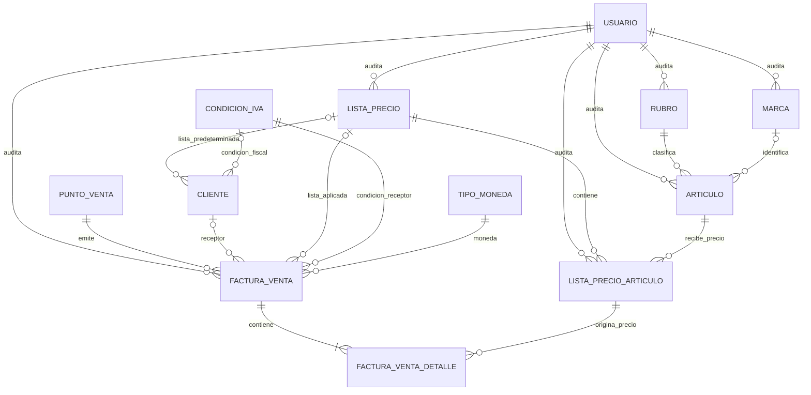
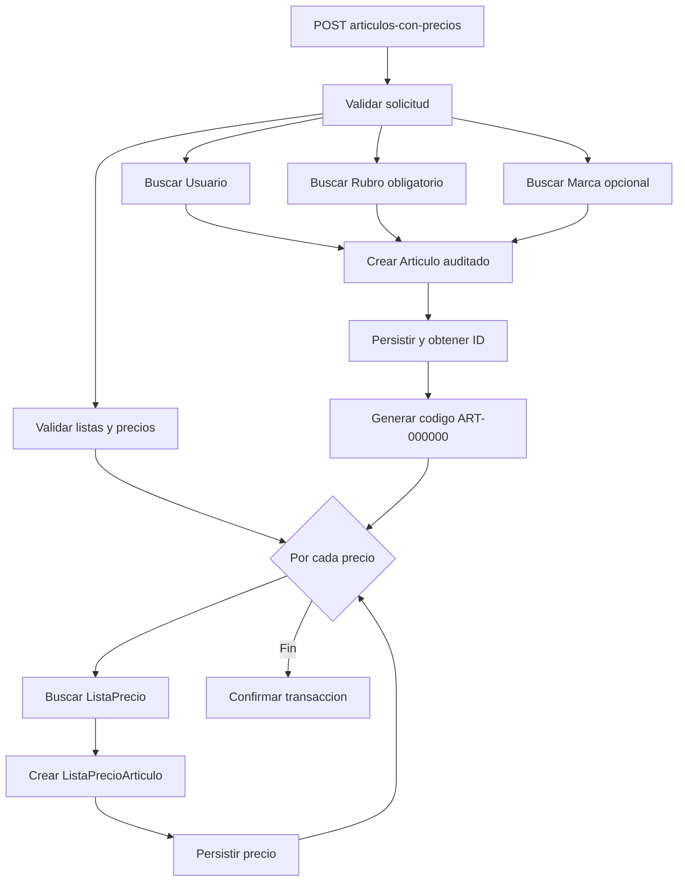
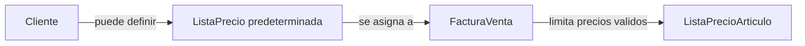
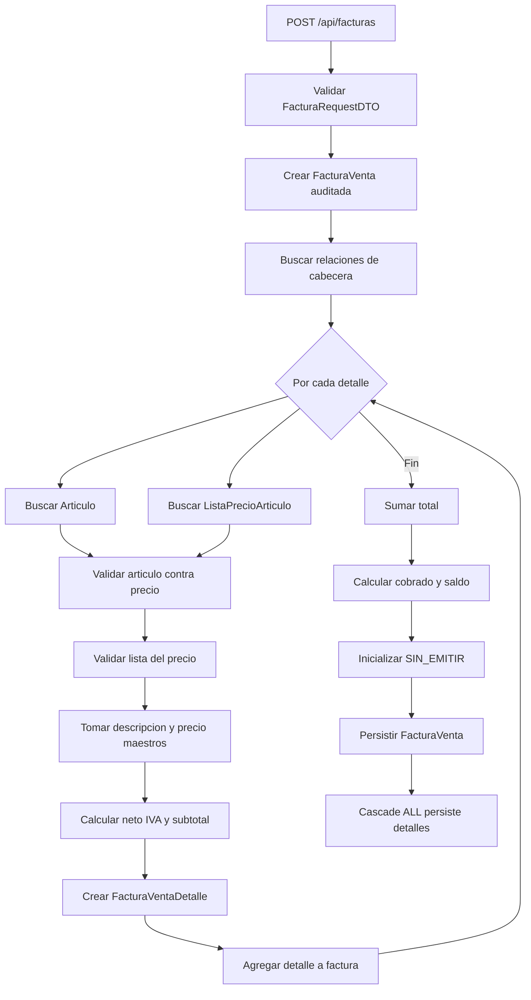
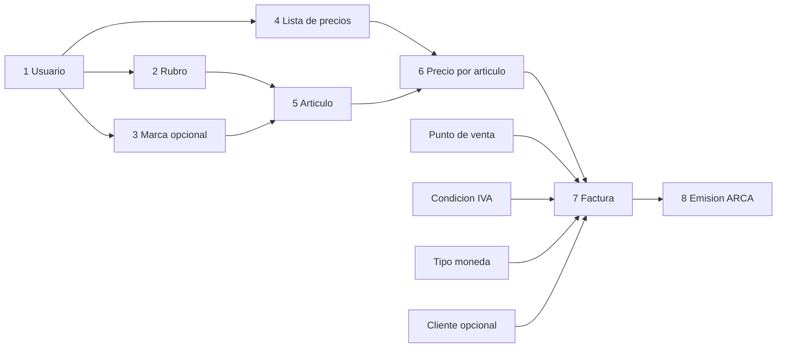

# Funcionamiento interno del modelo de facturación

Este documento describe cómo se relacionan y se crean los rubros, marcas, artículos, listas de precios, precios por artículo, clientes, facturas y detalles. También diferencia las responsabilidades del modelo JPA y de los servicios.

## 1. Alcance y nombre del documento

El título **Funcionamiento interno del modelo de facturación** abarca dos niveles:

- **Modelo de dominio y persistencia:** entidades JPA y relaciones almacenadas en MariaDB, como `Articulo`, `ListaPrecioArticulo`, `FacturaVenta` y `FacturaVentaDetalle`.
- **Capa de servicios:** reglas que validan solicitudes, buscan relaciones por ID, calculan importes y crean o modifican entidades. Las clases centrales son `DatosMaestrosService` y `FacturaService`.

“Servicio de facturación” sería un título demasiado limitado porque el documento no trata solamente una clase de servicio.

## 2. Datos maestros y datos transaccionales

Los **datos maestros** son registros reutilizables que deben existir antes de facturar:

- usuario;
- rubro y marca;
- artículo;
- lista de precios;
- precio del artículo dentro de una lista;
- cliente;
- condición de IVA;
- moneda;
- punto de venta.

Los **datos transaccionales** representan la venta:

- cabecera `FacturaVenta`;
- renglones `FacturaVentaDetalle`;
- importes calculados;
- estado y datos fiscales de ARCA.

## 3. Diagrama general de relaciones



La relación central del catálogo es:

```text
ListaPrecio 1 ---- N ListaPrecioArticulo N ---- 1 Articulo
```

`ListaPrecioArticulo` resuelve una relación muchos a muchos con un dato adicional: `precioVenta`. Un mismo artículo puede tener valores diferentes en las listas minorista, mayorista u otra.

## 4. Rubros, marcas y artículos

### Rubro

`Rubro` clasifica artículos por categoría. Tiene ID, código, denominación y auditoría.

```text
Un Rubro puede clasificar muchos Articulos.
Cada Articulo debe pertenecer a un Rubro.
```

Al crearlo, el servicio persiste el rubro para obtener su ID y luego usa ese ID como `codigo`.

### Marca

`Marca` identifica comercialmente al artículo. También tiene ID, código, denominación y auditoría.

```text
Una Marca puede identificar muchos Articulos.
La Marca es opcional para un Articulo.
```

Su código se genera con el mismo procedimiento que el del rubro.

### Artículo

`Articulo` representa el producto facturable.

| Campo o relación | Regla |
|---|---|
| `codigo` | Código interno del producto. |
| `denominacion` | Nombre comercial que luego se copia al detalle. |
| `rubro` | Obligatorio. |
| `marca` | Opcional. |
| Auditoría | Registra alta, modificación y baja lógica. |

El artículo **no guarda un precio propio**. El precio depende de la lista y se almacena en `ListaPrecioArticulo`.

## 5. Cómo se crean rubros y marcas

### Crear rubro

```http
POST /api/datos-maestros/rubros
Content-Type: application/json
```

```json
{
  "denominacion": "Informática",
  "usuarioId": 1
}
```

`DatosMaestrosService.crearRubro`:

1. busca el usuario de auditoría;
2. valida la denominación;
3. crea y audita el rubro;
4. lo persiste para obtener el ID;
5. asigna el ID como código;
6. devuelve ID y denominación.

### Crear marca

```http
POST /api/datos-maestros/marcas
```

```json
{
  "denominacion": "Logitech",
  "usuarioId": 1
}
```

`crearMarca` aplica el mismo procedimiento.

Los endpoints `DELETE` de rubros y marcas realizan **baja lógica**: completan `fechaBaja` y `usuarioBaja` sin borrar físicamente la fila.

## 6. Listas de precios

### ListaPrecio

`ListaPrecio` representa una política comercial, por ejemplo:

- `MINORISTA`;
- `MAYORISTA`;
- `DISTRIBUIDOR`.

| Campo | Regla |
|---|---|
| `codigo` | Obligatorio, único y normalizado a mayúsculas. |
| `denominacion` | Nombre descriptivo. |
| Auditoría | Usuario y fecha de cada operación. |

### ListaPrecioArticulo

Es la entidad que une:

- una lista;
- un artículo;
- un precio de venta.

| Artículo | Lista | Precio |
|---|---|---:|
| Teclado mecánico | Minorista | 45.000,00 |
| Teclado mecánico | Mayorista | 38.000,00 |
| Mouse óptico | Minorista | 18.000,00 |

La restricción única `uk_lista_precio_articulo` impide repetir:

```text
(lista_precio_id, articulo_id)
```

Un artículo puede tener muchos precios, pero solo uno por lista.

### Crear una lista

```http
POST /api/datos-maestros/listas-precio
```

```json
{
  "codigo": "MINORISTA",
  "denominacion": "Precio minorista",
  "usuarioId": 1
}
```

El servicio normaliza el código, comprueba que no exista y persiste la lista con auditoría.

### Agregar un precio a un artículo existente

```http
POST /api/datos-maestros/precios-articulo
```

```json
{
  "listaPrecioId": 1,
  "articuloId": 10,
  "precioVenta": 45000.00,
  "usuarioId": 1
}
```

El servicio:

1. busca lista, artículo y usuario;
2. rechaza precios negativos;
3. comprueba que la combinación no exista;
4. crea `ListaPrecioArticulo`.

## 7. Formas de crear un artículo

### Crear solamente el artículo

```http
POST /api/datos-maestros/articulos
```

```json
{
  "codigo": "TEC-001",
  "denominacion": "Teclado mecánico",
  "rubroId": 1,
  "marcaId": 2,
  "usuarioId": 1
}
```

Esta operación busca las relaciones, crea `Articulo` y conserva el código recibido, pero no crea precios. Luego se deben agregar mediante `POST /precios-articulo`.

### Crear el artículo junto con sus precios

```http
POST /api/datos-maestros/articulos-con-precios
```

```json
{
  "codigo": "VALOR-REQUERIDO-POR-EL-DTO",
  "denominacion": "Teclado mecánico",
  "rubroId": 1,
  "marcaId": 2,
  "usuarioId": 1,
  "precios": [
    {
      "listaPrecioId": 1,
      "precioVenta": 45000.00
    },
    {
      "listaPrecioId": 2,
      "precioVenta": 38000.00
    }
  ]
}
```

Dentro de una sola transacción, `crearArticuloConPrecios`:

1. valida cuerpo, denominación y al menos un precio;
2. rechaza listas repetidas y precios negativos;
3. busca usuario, rubro, marca y listas;
4. crea el artículo con un código temporal;
5. hace `flush` para obtener el ID;
6. genera el código definitivo `ART-000010`, con seis dígitos;
7. crea una fila `ListaPrecioArticulo` por cada lista;
8. confirma todos los cambios juntos.

> En este flujo el código definitivo se genera a partir del ID. Aunque el DTO recibe `codigo`, el servicio actual lo reemplaza con `ART-` más el ID de seis dígitos.

Si falla una lista o un precio, la transacción completa se revierte.

### Diagrama del alta integral



## 8. Edición y baja de artículos

`PUT /api/datos-maestros/articulos/{articuloId}` actualiza denominación, rubro, marca y precios.

Para cada lista recibida:

- si el precio no existe, lo crea;
- si estaba inactivo, lo reactiva;
- si está activo, actualiza `precioVenta`.

Los precios de listas que ya no aparecen en la solicitud reciben baja lógica.

Al desactivar un artículo, también se desactivan sus precios activos. Las filas se conservan para mantener las referencias históricas.

## 9. Lista predeterminada del cliente

Un `Cliente` puede tener una `listaPrecioPredeterminada`.



`FacturaService` puede tomar la lista del cliente cuando se crea una factura sin lista explícita. Sin embargo, el DTO y la validación REST actuales exigen `listaPrecioId`, por lo que el alta vigente requiere enviarla.

## 10. Factura y detalles

### Cabecera: FacturaVenta

Relaciona:

- punto de venta;
- cliente opcional;
- lista de precios;
- condición de IVA;
- moneda;
- detalles;
- importes total, cobrado y saldo;
- estado y datos fiscales.

El borrador se inicializa con:

```text
numero = null
fechaEmision = null
cae = null
estado = SIN_EMITIR
```

### Renglón: FacturaVentaDetalle

Cada detalle pertenece a una factura y referencia una fila concreta de `ListaPrecioArticulo`:

```text
FacturaVentaDetalle
    -> ListaPrecioArticulo
        -> Articulo
        -> ListaPrecio
```

No existe relación JPA directa desde el detalle hacia `Articulo`. El artículo se alcanza mediante el precio. El request exige ambos IDs para verificar que correspondan entre sí.

El detalle copia:

- denominación;
- precio unitario;
- cantidad y bonificación;
- porcentaje e importe de IVA;
- neto y subtotal.

Así se preservan los valores usados en la venta aunque el catálogo cambie después.

## 11. Creación de una factura

```http
POST /api/facturas
```

```json
{
  "puntoVentaId": 1,
  "clienteId": null,
  "listaPrecioId": 1,
  "condicionIvaId": 1,
  "tipoMonedaId": 1,
  "usuarioId": 1,
  "importeCobrado": 0,
  "observaciones": "Venta de mostrador",
  "detalles": [
    {
      "articuloId": 10,
      "listaPrecioArticuloId": 25,
      "cantidad": 2,
      "porcentajeBonificacion": 10
    }
  ]
}
```

`FacturaService.crear`:

1. valida cabecera y existencia de detalles;
2. crea la cabecera y su auditoría;
3. busca punto de venta, lista, condición de IVA, moneda y cliente;
4. valida la condición fiscal del cliente;
5. crea y calcula los detalles;
6. calcula cobrado y saldo;
7. inicializa el estado `SIN_EMITIR`;
8. persiste cabecera y detalles en una transacción.

## 12. Validación y origen de los datos del detalle

Para cada renglón, el servicio:

1. exige `articuloId` y `listaPrecioArticuloId`;
2. exige cantidad mayor que cero;
3. busca artículo y precio;
4. comprueba que el precio pertenezca al artículo;
5. comprueba que el precio pertenezca a la lista de la factura;
6. obtiene precio y descripción desde los datos maestros;
7. aplica IVA predeterminado del 21 %;
8. calcula y guarda los importes.

Aunque `FacturaDetalleRequestDTO` admite `descripcion`, `precioUnitario` y `porcentajeIva`, el servicio actual no usa esos valores para calcular:

| Dato | Fuente efectiva |
|---|---|
| Descripción | `Articulo.denominacion` |
| Precio unitario | `ListaPrecioArticulo.precioVenta` |
| IVA | `IVA_PREDETERMINADO = 21.00` |
| Cantidad | Request |
| Bonificación | Request, o cero |

Así el cliente HTTP no puede sustituir el precio del catálogo ni el IVA aplicado por el backend.

## 13. Fórmulas

```text
bruto = cantidad × precioUnitario
descuento = bruto × porcentajeBonificacion / 100
importeNeto = bruto - descuento
importeIva = importeNeto × 21 / 100
importeSubtotal = importeNeto + importeIva

importeTotal = suma de importesSubtotal
importeSaldo = importeTotal - importeCobrado
```

Neto, IVA, subtotal, total, cobrado y saldo se manejan con `BigDecimal` y se redondean a dos decimales con `HALF_UP`. El importe cobrado debe estar entre cero y el total.

Ejemplo para dos unidades de 45.000,00 con 10 % de bonificación:

```text
bruto = 2 × 45.000,00 = 90.000,00
descuento = 9.000,00
neto = 81.000,00
IVA = 17.010,00
subtotal = 98.010,00
```

## 14. Flujo interno de la factura



## 15. Persistencia en cascada

La relación está configurada así:

```java
@OneToMany(mappedBy = "factura", cascade = CascadeType.ALL, orphanRemoval = true)
```

Esto implica:

- guardar la factura guarda sus detalles;
- reemplazar la colección elimina los detalles anteriores;
- eliminar físicamente un borrador elimina sus detalles;
- `agregarDetalle` añade el renglón y también asigna su referencia a la factura.

Toda la creación es transaccional: ante una validación o relación inválida se revierte la operación.

## 16. Edición, eliminación y emisión

- **Edición:** solo una factura `SIN_EMITIR` puede modificarse. Si llegan detalles nuevos, se reemplazan todos y se recalcula.
- **Eliminación:** solo un borrador puede eliminarse físicamente; los detalles se eliminan en cascada.
- **Emisión:** se bloquean factura y punto de venta, se llama a ARCA y, si aprueba, se guardan número, fecha, CAE y vencimiento. El estado pasa a `EMITIDA`.
- **Inmutabilidad:** una factura emitida o anulada no se edita como borrador.

## 17. Auditoría

`Rubro`, `Marca`, `Articulo`, `ListaPrecio`, `ListaPrecioArticulo`, `Cliente` y `FacturaVenta` heredan de `AuditoriaApp`.

| Campo | Significado |
|---|---|
| `fechaAlta` | Creación. |
| `fechaModificacion` | Última modificación. |
| `fechaBaja` | Baja lógica; `null` significa activo. |
| `usuarioCarga` | Usuario creador. |
| `usuarioModificacion` | Responsable de la última modificación. |
| `usuarioBaja` | Responsable de la baja. |

`FacturaVentaDetalle` hereda solamente el ID porque su ciclo de vida depende de la factura.

## 18. Orden recomendado de creación



Orden práctico:

1. identificar el usuario;
2. crear rubro;
3. crear marca si corresponde;
4. crear una o más listas;
5. crear el artículo con precios, o crear artículo y luego precios;
6. obtener los IDs de `ListaPrecioArticulo`;
7. crear la factura con artículo y precio compatibles;
8. revisar el borrador;
9. emitir con ARCA.

## 19. Reglas fundamentales

1. Todo artículo pertenece a un rubro.
2. La marca es opcional.
3. El precio pertenece a la combinación artículo-lista.
4. No se puede repetir esa combinación.
5. Cada detalle referencia el precio concreto usado.
6. El artículo del request debe coincidir con el artículo del precio.
7. El precio debe pertenecer a la lista de la factura.
8. El backend toma descripción, precio e IVA de sus reglas internas.
9. Toda factura debe contener al menos un detalle.
10. Cabecera y detalles se crean en una transacción.
11. Un borrador puede editarse o eliminarse.
12. Una factura emitida no se modifica como borrador.
